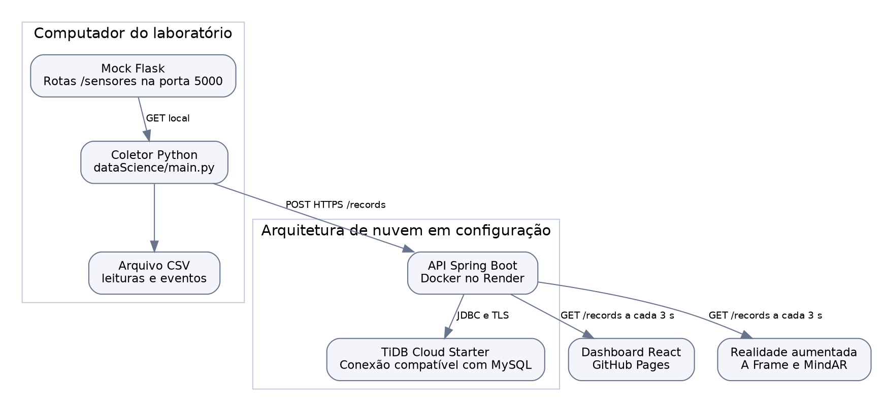
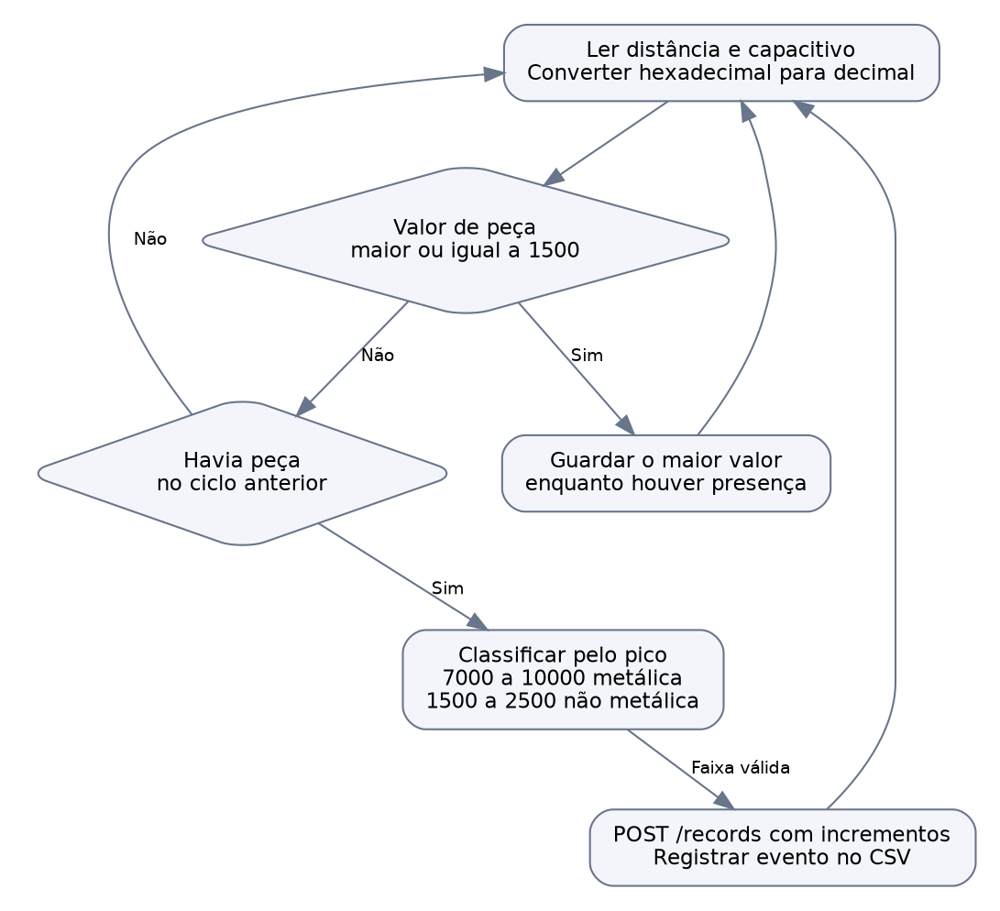
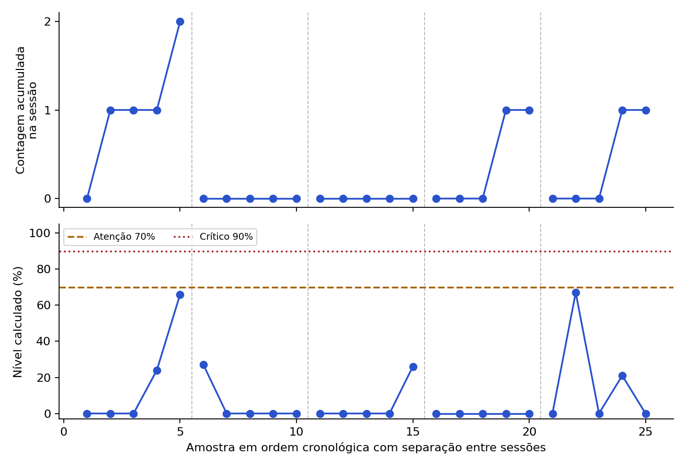
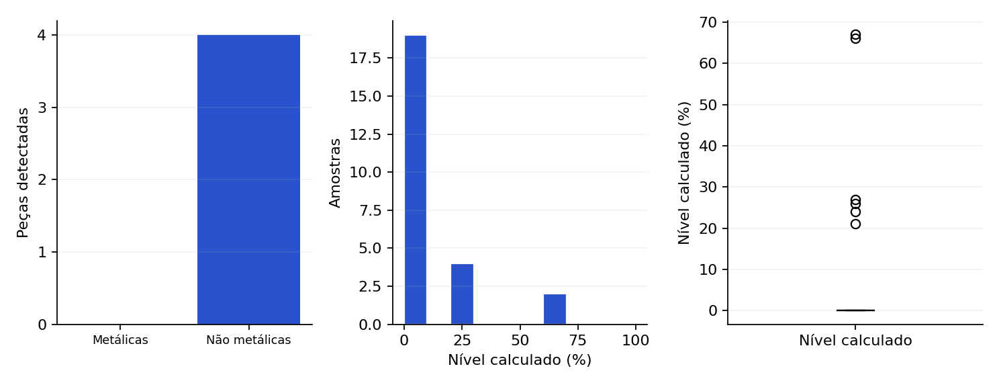
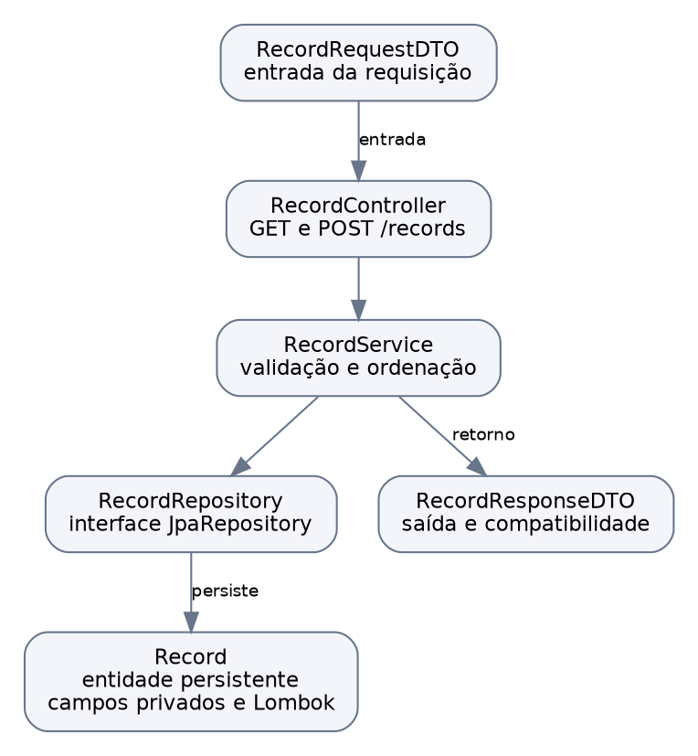
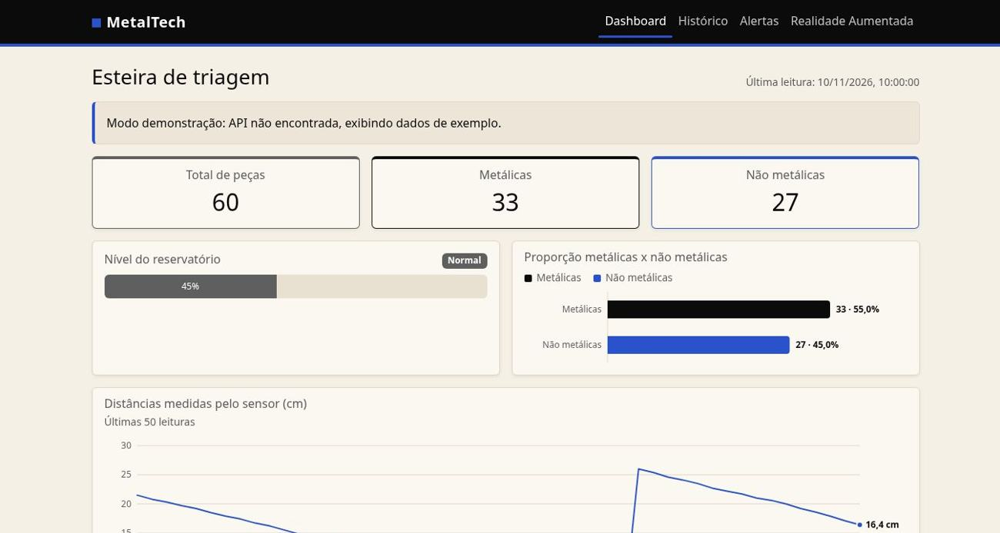
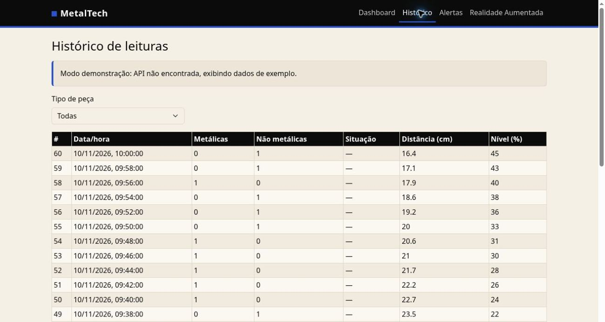
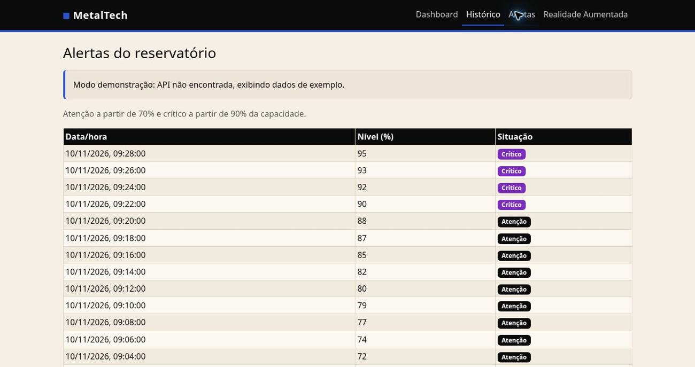

# Relatório técnico do projeto MetalTech

Samuel Santana Pereira Campos, João Paulo Oliveira, Eduardo Bruno Coppi e Beatriz Cardoso Rocha.

Projeto Interdisciplinar II · SENAI · São Carlos SP · 17 de novembro de 2026.

## Ficha de Identificação do Projeto

| Campo | Informação |
| --- | --- |
| Projeto | Plataforma Inteligente de Monitoramento Industrial com Realidade Aumentada |
| Cenário | MetalTech Indústria e Manufatura Ltda., empresa fictícia e esteira didática de triagem |
| Curso e período | Análise e Desenvolvimento de Sistemas, segundo semestre de 2026 |
| Equipe | Samuel Santana Pereira Campos, João Paulo Oliveira, Eduardo Bruno Coppi e Beatriz Cardoso Rocha |
| Unidades curriculares | Automação Industrial, Ciência de Dados, Computação em Nuvem, Desenvolvimento Back-end, Eletiva I Realidade Aumentada e Frameworks Front-end |
| Versão documentada | 35d2d63bb059 da branch master |
| Data e versão do relatório | 17 de novembro de 2026, versão 1.0 |
| Ambiente de coleta atual | Mock Flask local e coletor Python |

O relatório descreve a implementação e os resultados disponíveis, apresenta a análise dos CSVs de teste e registra a configuração de nuvem em andamento. O painel publicado apresentou modo demonstração na verificação de 17 de novembro de 2026. A validação do fluxo completo com a API hospedada permanece uma etapa de integração.

Repositório e versão de referência
https://github.com/helloojohnzz/monitoramento-industrial/tree/35d2d63bb0591698c9e4e58e905aab7febafc0c5

Atividade e modelo do relatório
https://classroom.google.com/c/ODk4NTQ0MjM5MzAy/a/ODgzNDA4MjA0MjEy/details

## Sumário

1 Introdução

2 Referencial Teórico

3 Metodologia

4 Desenvolvimento

5 Resultados e Discussão

6 Conclusão

7 Referências Bibliográficas

Apêndice A Código Fonte

Apêndice B Scripts SQL

Apêndice C Documentação da API

## 1 Introdução

### 1 1 Contextualização

A situação problema apresenta a MetalTech, empresa fictícia cuja esteira de triagem é interrompida para conferência manual das peças e do reservatório. A ausência de registros contínuos dificulta acompanhar a quantidade produzida e a proporção entre materiais. O projeto reúne coleta, processamento, armazenamento e visualização para disponibilizar essas informações em interfaces web e de realidade aumentada.

### 1 2 Justificativa

A coleta automática permite registrar eventos de passagem, reconstruir o histórico de produção e observar alterações de nível. Uma API comum reduz diferenças de interpretação entre o dashboard e a realidade aumentada. O uso de um mock permite exercitar a comunicação e os cálculos durante a preparação da integração com os equipamentos do laboratório.

### 1 3 Objetivos

#### 1 3 1 Objetivo Geral

Desenvolver uma plataforma de monitoramento industrial que integre as seis unidades curriculares em um produto capaz de receber leituras, registrar a produção, gerar indicadores e apresentar as informações em um dashboard React e em uma aplicação de realidade aumentada.

#### 1 3 2 Objetivos Específicos

• Ler distância e presença de peças, converter os dados de processo e classificar os eventos de passagem.

• Persistir os incrementos de produção e disponibilizá-los por uma API REST com contrato compartilhado.

• Analisar medidas de tendência central e dispersão, visualizar as séries e discutir possíveis valores atípicos.

• Consultar a mesma base nas interfaces web e de realidade aumentada, com atualização periódica.

• Documentar a hospedagem, o modelo de dados, a execução local e os testes de integração.

### 1 4 Estrutura do Documento

A seção 2 reúne a fundamentação das disciplinas. A seção 3 apresenta o método de desenvolvimento. A seção 4 detalha a arquitetura e os módulos. As seções 5 e 6 discutem resultados, limitações e continuidade. Os apêndices apresentam trechos do código, SQL de referência e o contrato da API.

## 2 Referencial Teórico

### 2 1 Indústria 4 0 e Monitoramento Industrial

O cenário de integração industrial conecta o processo físico ao sistema de informação. Sensores produzem medidas, uma camada de coleta identifica eventos e o software transforma as leituras em registros consultáveis. A aplicação acadêmica desse fluxo é o acompanhamento da triagem, mantendo rastreabilidade entre o sinal coletado e a informação exibida ao operador. O enunciado do SENAI define esse fluxo como o eixo do trabalho integrado [1].

### 2 2 Automação Industrial Sensores e Controladores

Sensores indutivos detectam alvos metálicos por interação eletromagnética. Sensores capacitivos identificam alterações de capacitância e podem detectar diferentes materiais. Um sensor de distância fornece uma medida que pode representar a passagem de uma peça ou a distância até o conteúdo do reservatório. O mestre IO-Link concentra as leituras e permite integrá-las ao sistema de TI. O material da disciplina referencia o mestre ifm AL1300 com interface PROFINET [3].

A combinação indutivo e capacitivo prevista pelo enunciado exige associação temporal dos sinais à mesma peça. No mock atual, a classificação usa faixas de um único valor capacitivo. A validação com três sensores e o circuito elétrico constituem uma etapa de implementação física descrita na seção 4.2.

### 2 3 Ciência de Dados

A média descreve o centro aritmético, a mediana divide a série ordenada e a moda identifica os valores mais frequentes. O desvio padrão quantifica a dispersão. Os quartis Q1 e Q3 delimitam a metade central dos dados. O boxplot permite visualizar esses elementos e examinar observações fora das cercas de 1,5 vezes o intervalo interquartil [4].

Gráficos de linha mostram evolução temporal. Barras comparam categorias e histogramas mostram a distribuição de uma variável quantitativa. A interpretação depende da origem dos dados e da unidade. Um sinal transitório de passagem e uma medição de ocupação precisam de calibração e de significado físico definido antes de sustentarem um alerta operacional.

### 2 4 Computação em Nuvem

IaaS disponibiliza infraestrutura virtual para administração pelo cliente. PaaS fornece um ambiente gerenciado para executar aplicações. SaaS entrega um software pronto ao usuário. A arquitetura proposta utiliza PaaS para a API no Render, banco gerenciado para persistência e hospedagem estática para o frontend. Contêineres empacotam aplicação e dependências, e a imagem Docker pode ser construída pelo provedor a partir do repositório [5].

Disponibilidade envolve saúde da aplicação, recuperação e persistência dos dados. Escalabilidade envolve capacidade de atender crescimento. HTTPS e TLS protegem a comunicação. CORS define quais origens o navegador pode usar para ler respostas e a chave de API controla a escrita quando configurada.

### 2 5 Desenvolvimento Back end e API REST

A API organiza requisições HTTP em recursos. O projeto utiliza GET para consulta e POST para inserção no recurso /records. O Spring Boot fornece a infraestrutura web e configuração externa, enquanto o Spring Data JPA apoia a persistência por repositórios [6]. Os DTOs delimitam os dados de entrada e de saída. A entidade Record encapsula atributos, e o serviço concentra a validação.

CRUD compreende criação, leitura, atualização e exclusão. O controller atual implementa criação e leitura. O conjunto completo pedido no enunciado requer endpoints adicionais e testes. A interface de repositório aplica herança de infraestrutura e permite que o serviço dependa de uma abstração. O domínio atual concentra as medições em uma entidade.

### 2 6 Realidade Aumentada

A aplicação de realidade aumentada combina a imagem capturada pela câmera com objetos virtuais ancorados a um alvo reconhecido. O projeto usa A-Frame para a cena e MindAR para rastrear uma imagem de referência. A presença do alvo ativa a apresentação de um painel com contagens e de um cilindro cujo preenchimento representa o nível calculado [7, 8].

### 2 7 Frameworks Front end

React organiza a interface em componentes que recebem propriedades e mantêm estados. Alterações no estado causam nova renderização dos componentes dependentes [9]. O projeto usa React Router para navegação, Vite para desenvolvimento e build, e Bootstrap com React Bootstrap para layout e componentes responsivos. As representações gráficas são construídas no próprio código, incluindo elementos SVG.

## 3 Metodologia

### 3 1 Etapas de Desenvolvimento

O trabalho segue o fluxo definido no Classroom, com contrato comum entre coleta, API, banco e interfaces. A implementação foi examinada na revisão 35d2d63bb059. Os registros CSV versionados foram utilizados como base exploratória. A verificação visual do site publicado e os retornos de execução local informados pela equipe compõem as evidências de integração disponíveis.

| Etapa | Artefato ou condição observada |
| --- | --- |
| Definição do problema | Enunciado do projeto e modelo técnico disponibilizados no Classroom |
| Coleta didática | Mock Flask e scripts Python e JavaScript |
| Persistência | API Java e MySQL 8.4 no Docker Compose |
| Interfaces | Dashboard React e aplicação web de RA |
| Hospedagem | GitHub Pages publicado e configuração Render com TiDB em andamento |
| Validação | Consulta local GET /records com HTTP 200 e verificação do painel em demonstração |

### 3 2 Ferramentas e Tecnologias Utilizadas

| Tecnologia | Aplicação | Versão ou referência |
| --- | --- | --- |
| Java e Spring Boot | API e regras de validação | Java 21 e Spring Boot 4.1.2 |
| Spring Data JPA e Connector J | Mapeamento e conexão ao banco | Dependências definidas no pom.xml |
| MySQL e Docker Compose | Persistência local e orquestração | Imagem mysql 8.4 |
| Python e Flask | Mock local de sensores | Versões de execução a registrar pela equipe |
| Python e requests | Coleta HTTP e CSV | Scripts em dataScience |
| Node.js | Ponte IO-Link e análise alternativa | 18 ou superior conforme README |
| React e React Router | Interface e navegação | 18.3.1 e 6.26.2 nas dependências |
| Vite e Bootstrap | Build e responsividade | 5.4.8 e 5.3.3 nas dependências |
| A-Frame e MindAR | Cena e rastreamento de imagem | 1.6.0 e 1.2.5 no HTML |
| Render e TiDB Cloud Starter | API e banco gerenciados | Arquitetura em configuração |
| Git e GitHub Pages | Versionamento e frontend público | Branch master e pasta docs |

### 3 3 Divisão de Responsabilidades

A equipe é composta por Samuel Santana Pereira Campos, João Paulo Oliveira, Eduardo Bruno Coppi e Beatriz Cardoso Rocha. A distribuição nominal das disciplinas deve ser validada pelo grupo. O quadro abaixo organiza as frentes de trabalho sem atribuir individualmente atividades cuja autoria ainda depende dessa definição.

| Frente | Responsabilidade técnica |
| --- | --- |
| Automação Industrial | Montagem, calibração, combinação dos sensores e comunicação de campo |
| Ciência de Dados | Tratamento, medidas descritivas, gráficos e interpretação |
| Computação em Nuvem | Hospedagem, configuração externa, acesso e disponibilidade |
| Back end | Contrato, validação, persistência e testes |
| Front end e RA | Visualização, interação e consumo consistente da API |

## 4 Desenvolvimento

### 4 1 Arquitetura Geral e Fluxo Integrado

No ambiente de demonstração, o mock Flask responde na porta 5000. O coletor Python consulta os sinais localmente, identifica a saída da peça e envia um POST para a API. A API valida e grava um registro. O dashboard e a RA consultam GET /records a cada três segundos. O fluxo em nuvem depende da URL HTTPS da API e da conexão válida ao banco gerenciado.



Na execução local, Docker Compose sobe a API e o MySQL na mesma rede interna. A porta 8080 da API é publicada no computador. O banco conserva os dados no volume mysql_data e permanece disponível aos contêineres dessa rede. O endereço localhost sempre corresponde à máquina que executa a requisição.

| Consumidor | Contrato utilizado |
| --- | --- |
| Python e ponte IO-Link | POST /records com JSON |
| Dashboard React | GET /records e resposta em lista |
| Aplicativo de RA | GET /records e resposta em lista |
| Monitoramento da hospedagem | GET /actuator/health |

### 4 2 Automação Industrial Esteira de Triagem

#### 4 2 1 Circuito e Fluxograma de Funcionamento

A interface de campo prevista utiliza o mestre IO-Link. O mock substitui as respostas de processo por JSON com code e data.value hexadecimal. O esquema elétrico com alimentação, entradas, modelos e ligação física dos três sensores deve acompanhar a validação da bancada. O fluxograma abaixo representa o algoritmo existente em software.



#### 4 2 2 Sensores Utilizados

| Entrada | Uso atual | Condição física |
| --- | --- | --- |
| Distância | Mock /sensores/distancia e distância em cm com fator 0,1 | Modelo e calibração a confirmar em bancada |
| Capacitivo | Mock /sensores/capacitivo e pico de passagem | Faixas didáticas do script |
| Indutivo | Requisito de presença metálica no enunciado | A integração ao mock atual depende de implementação |

#### 4 2 3 Lógica de Classificação das Peças

O algoritmo atual identifica presença quando o valor é pelo menos 1500. Enquanto há presença, guarda o maior valor. Quando o sinal retorna abaixo desse limite, classifica o pico. A faixa 7000 a 10000 representa peça metálica e 1500 a 2500 representa peça não metálica. Valores fora das faixas são ignorados. A associação dessas faixas a materiais precisa de validação experimental.

| Indutivo | Capacitivo | Interpretação prevista para três sensores |
| --- | --- | --- |
| 0 | 0 | Ausência de peça na janela de detecção |
| 0 | 1 | Peça não metálica, após calibração |
| 1 | 0 | Metal detectado e divergência a verificar no posicionamento ou sincronismo |
| 1 | 1 | Peça metálica, com confirmação de presença |

Essa tabela expressa a combinação pedida na atividade. A versão atual do coletor utiliza o valor capacitivo e mantém a leitura indutiva como etapa de integração. Os eventos de queda estimados pelo sensor de distância são contados separadamente dos eventos de passagem na esteira.

#### 4 2 4 Envio de Dados para o Back end

| Parâmetro | Implementação |
| --- | --- |
| Método e destino | POST em API_URL, que inclui /records |
| Cadência Python | Envio por peça detectada em uma coleta de 20 s. Cada ciclo inclui HTTP e espera de 50 ms |
| Campos atuais | metalPieces, nonMetalPieces, situation, productionRate e distance |
| Tratamento Python | Timeout de 3 s e mensagem de falha. Reenvio persistente depende de implementação |
| Alternativa Node.js | ponte-iolink mantém fila em memória e envia o contrato legado isMetal, distance e tank |

O intervalo de espera de 50 ms define uma pausa mínima. A duração real do ciclo aumenta com as requisições. Uma falha de POST no Python deixa o registro no CSV, mas exige recuperação posterior para chegar ao banco.

### 4 3 Ciência de Dados Análise dos Dados da Esteira

#### 4 3 1 Base de Dados Analisada

A análise utiliza os cinco arquivos teste_producao_20261116 presentes em dataScience na revisão documentada. São 25 linhas em cinco sessões independentes, datadas de 16 de novembro de 2026 entre 21h09min00s e 21h43min16s, conforme os timestamps dos arquivos. Cada sessão contém cinco amostras. Esses dados são registros de teste com sinais na faixa do mock e a interpretação permanece didática.

| Sessão de 16 nov | Linhas | Metálicas | Não metálicas | Quedas no tanque ao final |
| --- | --- | --- | --- | --- |
| 20261116_210856 | 5 | 0 | 2 | 2 |
| 20261116_211422 | 5 | 0 | 0 | 1 |
| 20261116_212105 | 5 | 0 | 0 | 1 |
| 20261116_213015 | 5 | 0 | 1 | 0 |
| 20261116_214255 | 5 | 0 | 1 | 2 |

Os CSVs foram lidos com separador ponto e vírgula e remoção do BOM. Distâncias foram convertidas para número. Contagens de passagem foram obtidas pelas diferenças de total_geral dentro de cada sessão e pela classificação do evento peca_detectada. Eventos queda_tanque são mantidos como variável independente. Essa operação evita duplicar contadores acumulados.

#### 4 3 2 Estatística Descritiva

O desvio padrão é amostral, com divisor n menos 1. Q1 e Q3 usam percentis de 25% e 75% com interpolação linear. A coluna amodal indica que nenhum valor se repete. O nível usa a fórmula do frontend, arredondada e limitada entre 0% e 100%.

| Variável | Média | Mediana | Moda | DP | Q1 | Q3 |
| --- | --- | --- | --- | --- | --- | --- |
| Peças metálicas por amostra | 0,00 | 0,00 | 0 | 0,00 | 0,00 | 0,00 |
| Peças não metálicas por amostra | 0,16 | 0,00 | 0 | 0,37 | 0,00 | 0,00 |
| Distância em cm | 42,30 | 49,00 | 48.9 / 49 / 49.8 | 14,02 | 48,20 | 50,10 |
| Nível calculado em % | 9,24 | 0,00 | 0 | 19,51 | 0,00 | 0,00 |

Foram detectadas quatro peças não metálicas no conjunto. A ausência de eventos metálicos de passagem impede avaliar a discriminação dos dois tipos nessa amostra. Os sinais de queda metálica aparecem em outro evento e precisam ser interpretados separadamente da produção registrada.

#### 4 3 3 Visualizações



A contagem acumulada reinicia em cada sessão. Os segmentos do gráfico permanecem separados para preservar esse reinício e os intervalos entre coletas. O nível tem picos transitórios e longos trechos em zero após o limite aplicado pelo frontend. Esses padrões revelam a necessidade de distinguir queda de peça e ocupação efetiva do reservatório.



As barras resumem os eventos de produção. O histograma mostra a concentração em zero. O boxplot evidencia uma caixa degenerada nessa distribuição, em que a maior parte dos valores é igual. Os gráficos foram calculados especificamente para este relatório e complementam as visualizações implementadas no dashboard.

#### 4 3 4 Outliers e Critério de Alerta

Para a distância bruta convertida em cm, Q1 é 48,20 e Q3 é 50,10. A regra de 1,5 vezes o intervalo interquartil identifica seis observações baixas como possíveis valores atípicos. Elas correspondem às faixas simuladas de passagem ou queda, cuja natureza operacional pode explicar o desvio. Sua identificação estatística exige interpretação do evento [4].

No nível calculado, Q1 e Q3 são ambos zero. Aplicar mecanicamente a cerca interquartil marcaria todos os valores positivos. Por isso, o critério adotado na interface usa limites operacionais fixos de 70% para atenção e 90% para crítico, com calibração pendente para a bancada.

A fórmula implementada considera N = 100 × (30 − d) / 30, onde d está em centímetros. O resultado é arredondado e limitado entre zero e cem. Dezenove das 25 distâncias são maiores que 30 cm e viram nível zero. O mock gera repouso entre 48 e 52 cm. A altura de referência de 30 cm e essa faixa de simulação precisam ser compatibilizadas antes de atribuir significado físico ao preenchimento.

A amostra alcança nível calculado máximo de 67%, portanto os CSVs analisados apresentam zero amostras nos limites de atenção ou crítico. Já os dados de demonstração do frontend incluem níveis de até 95%, permitindo verificar visualmente as duas categorias. As bases têm finalidades distintas e devem ser identificadas na apresentação.

| Indicador | Resultado na base de teste |
| --- | --- |
| Registros analisados | 25 amostras em cinco sessões |
| Distâncias acima da altura de referência | 19 amostras, equivalentes a 76% |
| Possíveis outliers de distância pela regra IQR | 6 observações baixas |
| Eventos de passagem registrados | 0 metálicos e 4 não metálicos |
| Amostras com alerta de nível | 0 em atenção e 0 em crítico |

O relatório JavaScript existente produz média, mediana, desvio padrão, barras e linha. Moda, quartis, histograma e boxplot foram acrescentados à análise documental. A publicação desses indicadores como parte do produto permanece uma evolução do módulo de Ciência de Dados.

### 4 4 Computação em Nuvem Arquitetura e Segurança

A configuração escolhida durante a integração utiliza Render para executar a imagem Docker e TiDB Cloud Starter para o banco com protocolo MySQL. O frontend permanece no GitHub Pages. O documento nuvem/README.md do repositório ainda cita Aiven, enquanto o ambiente em configuração utiliza TiDB. A figura 1 representa a configuração atual pretendida.

| Aspecto | Decisão e justificativa |
| --- | --- |
| Modelo de serviço | PaaS no Render para reduzir administração de sistema operacional e gerenciar a execução da API |
| Banco | TiDB Cloud Starter em modo compatível com MySQL. A conexão da aplicação usa Connector J e JDBC com TLS |
| Acesso de escrita | ApiKeyFilter exige X-API-Key quando API_KEY está preenchida. No teste informado pela equipe, foi escolhida chave vazia |
| Leitura e CORS | GET público. CORS_ALLOWED_ORIGINS deve conter https://helloojohnzz.github.io |
| Trânsito | HTTPS nos clientes e JDBC com sslMode=VERIFY_IDENTITY para verificar o certificado e o hostname do banco |
| Repouso e recuperação | Políticas, disponibilidade de backup e restauração devem ser verificadas no plano do banco contratado |
| Disponibilidade | Health check /actuator/health e acompanhamento dos logs de deploy |
| Escalabilidade | API sem armazenamento local de sessão. Capacidade e custo dependem dos planos e do volume de consultas |
| Custos | TiDB Starter configurado com spending limit zero. Consumo acima da cota pode restringir o serviço [10] |

Credenciais do banco ficam nas variáveis do serviço. O build do frontend recebe apenas a URL pública em VITE_API_URL. O banco local do Compose pertence ao computador do laboratório. Sua publicação ou migração é uma operação específica e depende de acesso ao serviço de destino.

A URL definitiva da API e a aprovação do deploy devem ser registradas após os testes de saúde e de leitura pela nuvem. A validação inclui também a gravação pelo coletor local e a consulta do mesmo registro pelas duas interfaces.

### 4 5 Desenvolvimento Back end API REST

#### 4 5 1 Modelagem Orientada a Objetos

Record representa a medição persistida. RecordRequestDTO recebe os campos da requisição e RecordResponseDTO organiza a resposta com compatibilidade para registros legados. RecordController delega as operações ao RecordService, que valida valores e acessa RecordRepository. O repositório herda JpaRepository e opera com identificador Long.



Os atributos privados da entidade e os acessores gerados por Lombok implementam encapsulamento. A herança de JpaRepository e a implementação da interface pelo framework permitem persistência por abstração. O requisito de modelar esteira, sensores, peças e usuários em classes próprias permanece uma ampliação do domínio. A estrutura atual concentra a medição em Record.

#### 4 5 2 Modelo do Banco de Dados

A entidade mapeia a tabela records, com chave primária id e geração por identidade. Não há relacionamento entre tabelas definido nesse modelo. O horário é atribuído no servidor da API na criação. O banco preserva os incrementos recebidos, e as interfaces somam esses valores para obter o total.

| Campo | Tipo lógico | Regra |
| --- | --- | --- |
| id | Long | Chave primária gerada por identidade |
| dateTime | LocalDateTime | Horário do registro atribuído pelo servidor |
| situation | String | Obrigatório no contrato atual e preservado conforme enviado |
| productionRate | Double | Obrigatório, finito e não negativo no contrato atual |
| metalPieces | Integer | Incremento de peças metálicas, não negativo |
| nonMetalPieces | Integer | Incremento de peças não metálicas, não negativo |
| distance | Double | Opcional, finito e não negativo quando informado |
| isMetal e tank | Boolean e String | Campos legados conservados para compatibilidade |

#### 4 5 3 Endpoints e Documentação da API

| Método | Rota | Resposta implementada |
| --- | --- | --- |
| GET | /records | HTTP 200 e lista ordenada por dateTime e id |
| POST | /records | HTTP 200 e DTO do registro criado |
| GET | /actuator/health | Saúde da aplicação por Actuator |

O serviço devolve HTTP 400 para medições inválidas. O filtro pode devolver HTTP 401 em operações de escrita, caso a chave seja exigida. O controller atual implementa GET e POST. Atualização, exclusão e consulta individual exigidas no CRUD completo ainda precisam de implementação. A documentação de uso está no apêndice C.

#### 4 5 4 Testes Automatizados e Versionamento

O repositório contém a classe MonitoramentoIndustrialApplicationTests, com o teste contextLoads, e dependências de teste no Maven. O Dockerfile compila usando -DskipTests. A presença da classe de teste confirma o artefato, e a cobertura dos fluxos de validação e persistência exige execução e testes específicos. Nenhuma porcentagem de cobertura foi calculada neste relatório.

O versionamento utiliza Git e o repositório público no GitHub. Este documento está vinculado à revisão 35d2d63bb059. Mudanças posteriores devem atualizar o contrato, os exemplos e os resultados reproduzidos. A estratégia de revisão e atribuição individual de tarefas será definida pela equipe.

### 4 6 Dashboard Web React

#### 4 6 1 Estrutura de Rotas e Componentes

| Rota | Componente | Propriedades e estados |
| --- | --- | --- |
| / | Dashboard | Recebe leituras, loading e erro. Calcula totais, taxa, proporções e nível |
| /historico | Historico | Recebe as mesmas propriedades e mantém estado filtro por tipo |
| /alertas | Alertas | Calcula nível e seleciona registros a partir de 70% |
| Demais caminhos | NaoEncontrada | Exibe orientação para rota desconhecida |

App executa useFetch uma vez e repassa os dados às páginas. O hook realiza fetch inicial e novas consultas a cada 3000 ms. Antes da primeira resposta válida, uma falha pode ativar os dados de demonstração. Após receber dados da API, falhas posteriores mantêm as últimas leituras e apresentam aviso. O temporizador é removido quando o efeito é encerrado.

#### 4 6 2 Telas do Dashboard

A tela principal apresenta total de peças, contagens por tipo, taxa quando disponível, proporção, distâncias, agrupamento por hora e últimas medições de nível. Bootstrap organiza as colunas para telas distintas. Os gráficos SVG usam a largura do contêiner. O histórico filtra por tipo. O filtro de período citado no modelo acadêmico permanece uma ampliação da interface.







Na consulta visual, o painel apresentou 60 peças, sendo 33 metálicas e 27 não metálicas, e nível atual de 45%. A tabela de alertas apresentou 14 registros, dos quais quatro críticos. Esses valores pertencem ao arquivo demonstrativo do frontend. A atualização automática com registros provenientes do Render depende da configuração e validação da API pública.

A responsividade está prevista nos componentes por breakpoints e ajuste de largura. A validação visual em dispositivo móvel e a evidência correspondente devem integrar os testes de apresentação. As capturas acima documentam a interface desktop observada.

### 4 7 Eletiva I Aplicativo de Realidade Aumentada

#### 4 7 1 Marcador e Rastreamento

A aplicação usa A-Frame 1.6.0 e MindAR 1.2.5. O arquivo assets/esteira.mind contém o alvo utilizado na cena, e assets/esteira.jpg é a imagem de referência. O atributo mindar-image-target associa a entidade ao targetIndex zero. Eventos targetFound e targetLost alteram a indicação visual de reconhecimento.

A aplicação fica em realidade-aumentada e sua cópia de publicação em docs/ra. O navegador precisa de permissão para câmera. A configuração da API pode ser passada pelo parâmetro api da URL. Esse parâmetro recebe o endereço base HTTPS, e o código acrescenta /records.

#### 4 7 2 Sobreposição de Dados e Alertas

| Elemento | Fonte | Comportamento |
| --- | --- | --- |
| Contagens por material | GET /records | Soma metalPieces e nonMetalPieces com suporte a registros legados |
| Nível do reservatório | Última distance válida | Mesma referência de altura de 30 cm do dashboard |
| Cilindro de preenchimento | Nível calculado | Ajusta altura e posição para crescer a partir da base |
| Avisos de nível | Limites de 70% e 90% | Texto de atenção ou alerta e mudança de cor |
| Zoom | Interação do usuário | Botões e gesto de pinça com escala entre 0,5 e 3 |

A consulta é repetida a cada três segundos. Se a API falha, o módulo carrega dados-demo.json e informa modo demonstração. O reconhecimento em câmera, a ergonomia no dispositivo móvel e a concordância com a API publicada precisam de validação na bancada. O presente relatório documenta o código desse recurso e seu roteiro de verificação.

## 5 Resultados e Discussão

### 5 1 Funcionamento Integrado do Sistema

A execução local informada pela equipe mostrou API e banco ativos no Docker, com o MySQL saudável. GET /records retornou HTTP 200 e lista vazia. Esse retorno confirma a consulta local, enquanto a ausência de registros exige alimentar a API. Na verificação pública, o frontend exibiu explicitamente modo demonstração. A configuração do Render e do TiDB está em andamento, com validação de gravação e leitura ainda necessária.

### 5 2 Testes de Integração

| Teste | Resultado esperado | Evidência ou estado |
| --- | --- | --- |
| Docker local | API ativa e banco saudável | Confirmado pela saída docker compose ps fornecida pela equipe |
| GET local /records | HTTP 200 com lista JSON | Confirmado em retorno fornecido pela equipe, inicialmente [] |
| Navegação web | Dashboard, histórico e alertas acessíveis | Verificado no site publicado em modo demonstração |
| Cálculos dos CSVs | Medidas e gráficos reproduzíveis | Calculados para 25 amostras, conforme seção 4.3 |
| Mock para Render | POST de peça e persistência na nuvem | Validação pendente com URL definitiva e credenciais aplicadas |
| Atualização pelo Render | Novo registro visível sem recarregar a página | Roteiro de validação no apêndice C |
| RA em dispositivo | Reconhecimento de alvo e dados iguais aos da API | Validação em câmera pendente |
| Sensores físicos | Classificação consistente pelos três sensores | Calibração e circuito pendentes |

### 5 3 Dificuldades Encontradas

O diagnóstico identificou uso de localhost pelo frontend publicado, tentativas de consulta em porta sem serviço e ausência inicial de contêineres. Após a criação do Compose, o MySQL recusou MYSQL_USER igual a root. A correção do usuário regular permitiu subir o banco. Também ocorreu tentativa de acessar banco local a partir do Render, evidenciando a necessidade de persistência alcançável pela API hospedada.

A alternativa de túnel Cloudflare apresentou timeout no handshake TLS, tanto no Docker quanto no Windows. O trabalho passou a configurar a API diretamente no Render e um banco TiDB. A diferença entre o formato legado e os novos campos de produção exigiu compatibilidade no serviço, nos DTOs e nas interfaces.

### 5 4 Análise Crítica

A implementação permite demonstrar o contrato e as interfaces, mas a operação contínua requer coleta além dos 20 segundos, recuperação de falhas de envio e controle de duplicidade. O mock gera sinais aleatórios independentes, com validação física ainda necessária. A leitura integral de /records a cada ciclo cresce com o histórico. Paginação e consulta incremental podem reduzir o volume de transferência.

### 5 5 Verificação dos Entregáveis

| Entregável do Classroom | Artefato disponível | Validação restante |
| --- | --- | --- |
| Repositório back end e React | backend, frontend e docs | Fluxo com API hospedada e medições recentes |
| Automação e firmware | ponte-iolink e scripts de coleta | Circuito, modelos e combinação indutivo com capacitivo |
| Aplicativo de RA | realidade-aumentada e docs/ra | Reconhecimento em câmera com API da nuvem |
| Ciência de Dados | Scripts, CSVs e análise da seção 4.3 | Base maior, calibração e incorporação das análises ao produto |
| Arquitetura de nuvem | nuvem/README.md e seção 4.4 | Atualizar provedor para TiDB e comprovar deploy saudável |
| Apresentação integrada | Roteiro de demonstração no apêndice C | Apresentação final a preparar pela equipe |
| CRUD e testes | GET e POST, teste de contexto | Completar operações e testes de comportamento |

## 6 Conclusão

### 6 1 Considerações Finais

O projeto construiu uma base de integração entre coleta didática, API, persistência e duas interfaces. A API local respondeu com sucesso e o painel publicado apresentou os componentes e alertas usando dados demonstrativos. A análise das 25 amostras identificou quatro eventos de passagem não metálica, seis distâncias baixas atípicas pela regra IQR e incompatibilidade entre o repouso do mock e a altura adotada no cálculo do nível.

A conclusão do objetivo integrado depende de validar a persistência na nuvem, a consulta compartilhada por web e RA e a classificação dos sensores físicos. A documentação registra o contrato e os artefatos existentes e permite conduzir essa validação com critérios observáveis.

### 6 2 Trabalhos Futuros

As próximas entregas são calibrar os sinais e a altura do reservatório, integrar o indutivo, manter coleta contínua com fila persistente e identificador de evento, completar o CRUD e os testes, e validar a RA em dispositivo móvel. Para a nuvem, devem ser verificados os limites dos planos, a restauração dos dados e os controles de escrita escolhidos para a versão final. Uma API incremental e filtros por período podem apoiar o crescimento do histórico.

## 7 Referências Bibliográficas

[7] A FRAME. Introduction. Documentação oficial. Disponível em https://aframe.io/docs/1.6.0/introduction/. Acesso em 17 nov. 2026.

[11] EQUIPE METALTECH. Monitoramento Industrial. Código fonte, arquivos CSV e configuração. Revisão 35d2d63bb0591698c9e4e58e905aab7febafc0c5. Disponível em https://github.com/helloojohnzz/monitoramento-industrial/tree/35d2d63bb0591698c9e4e58e905aab7febafc0c5. Acesso em 17 nov. 2026.

[3] IFM. IO Link master com interface PROFINET AL1300. Documentação do produto. Disponível em https://www.ifm.com/br/pt/product/AL1300. Acesso em 17 nov. 2026.

[8] MINDAR. MindAR Documentation. Rastreamento de imagem. Disponível em https://hiukim.github.io/mind-ar-js-doc/. Acesso em 17 nov. 2026.

[4] NIST SEMATECH. e Handbook of Statistical Methods. Box Plot. Disponível em https://www.itl.nist.gov/div898/handbook/eda/section3/boxplot.htm. Acesso em 17 nov. 2026.

[10] PINGCAP. Create a TiDB Cloud Starter or Essential Instance. Documentação oficial. Disponível em https://docs.pingcap.com/tidbcloud/create-tidb-cluster-serverless/. Acesso em 17 nov. 2026.

[9] REACT. Quick Start. Documentação oficial. Disponível em https://react.dev/learn. Acesso em 17 nov. 2026.

[5] RENDER. Docker on Render. Documentação de publicação. Disponível em https://render.com/docs/docker. Acesso em 17 nov. 2026.

[1] SENAI. Projeto Interdisciplinar II Situação Problema. Plataforma Inteligente de Monitoramento Industrial com Realidade Aumentada. Material da turma Atividade Interdisciplinar 2 ADS, 2026. Disponível em https://drive.google.com/file/d/1hkiXM5W0QHJLam1sqxGu9qClHU7SnL00/view. Acesso em 17 nov. 2026.

[2] SENAI. Relatório Técnico Projeto Integrador. Modelo disponibilizado na turma Atividade Interdisciplinar 2 ADS, 2026. Disponível em https://drive.google.com/file/d/13A90R7lcm8SUVgvCx61v8DSnAfPsTJMc/view. Acesso em 17 nov. 2026.

[6] SPRING. Spring Boot. Documentação oficial. Disponível em https://spring.io/projects/spring-boot/. Acesso em 17 nov. 2026.

Os códigos e os CSVs do repositório constituem a fonte primária da descrição da implementação. Os materiais do Classroom estabelecem os requisitos e a estrutura do relatório. As capturas do painel foram obtidas em 17 de novembro de 2026 e identificadas como demonstração.

## Apêndices

### Apêndice A Código Fonte

#### A 1 Aquisição e processamento

A coleta em Python está em dataScience/main.py e o mock em dataScience/mock_iolink.py. A alternativa de campo contínua está em ponte-iolink/ponte.js. O trecho abaixo resume a leitura presente no coletor Python.

```python
dados = consultar_sensor_iolink(config["url"])
if not dados or dados.get("code") != 200:
    return None, None
hex_value = dados["data"]["value"]
return int(hex_value, 16), hex_value
```

A classificação da peça acontece ao fim do pulso. O valor de distância que acompanha o evento recebe fator 0,1. A versão completa de cada arquivo está na revisão de referência do repositório.

#### A 2 Código do Back end

```java
@RestController
@RequestMapping("/records")
public class RecordController {
    @Autowired
    private RecordService recordService;

    @GetMapping
    public List<RecordResponseDTO> getRecord() {
        return recordService.listRecords();
    }

    @PostMapping
    public RecordResponseDTO createRecord(@RequestBody RecordRequestDTO dto) {
        return recordService.createRecord(dto);
    }
}
```

#### A 3 Código do Front end

```javascript
export const API_URL = import.meta.env.VITE_API_URL || 'http://localhost:8080'
export const URL_LEITURAS = `${API_URL}/records`
export const INTERVALO_ATUALIZACAO = 3000

const { data: leituras, loading, erro } = useFetch(
  URL_LEITURAS, INTERVALO_ATUALIZACAO, dadosDemo.records
)
```

O código completo do hook, das páginas e dos cálculos está em frontend/src. As variáveis VITE são incorporadas no build do frontend.

#### A 4 Aplicativo de Realidade Aumentada

```html
<a-scene mindar-image="imageTargetSrc: ./assets/esteira.mind; uiScanning: no">
  <a-camera position="0 0 0" look-controls="enabled: false"></a-camera>
  <a-entity id="alvo" mindar-image-target="targetIndex: 0">
    <a-entity id="grupo-zoom">...</a-entity>
  </a-entity>
</a-scene>
```

O trecho abreviado representa a ancoragem da cena. O arquivo realidade-aumentada/index.html contém o painel completo, e app.js contém consulta, cálculo, cores e gestos.

#### A 5 Análise reproduzível dos CSVs

O procedimento abaixo calcula as medidas usando os CSVs versionados. Peças são incrementos por amostra e sessão. A moda é reportada como amodal quando todos os valores são únicos. O código utiliza desvio padrão amostral e quartis por interpolação linear.

```python
from pathlib import Path
import csv, math, statistics as st
import numpy as np
dados = {"metalicas": [], "nao_metalicas": [], "distancia": [], "nivel": []}
for arquivo in sorted(Path("dataScience").glob("teste_producao_*.csv")):
    anterior = 0
    with arquivo.open(encoding="utf-8-sig", newline="") as f:
        for r in csv.DictReader(f, delimiter=";"):
            incremento = int(r["total_geral"]) - anterior
            anterior = int(r["total_geral"])
            for nome, tipo in [("metalicas", "metalica"),
                               ("nao_metalicas", "nao_metalica")]:
                evento = r["evento"] == "peca_detectada"
                dados[nome].append(incremento if evento and
                                   r["classificacao"] == tipo else 0)
            d = float(r["sensor_1_cm"])
            dados["distancia"].append(d)
            dados["nivel"].append(min(100, max(0,
                math.floor((30 - d) / 30 * 100 + 0.5))))
for nome, valores in dados.items():
    q1, q3 = np.percentile(valores, [25, 75], method="linear")
    moda = st.multimode(valores)
    if len(moda) == len(valores): moda = "Amodal"
    print(nome, st.mean(valores), st.median(valores), moda,
          st.stdev(valores), q1, q3)
```

### Apêndice B Scripts SQL

O DDL abaixo é uma representação de referência da entidade Record. O código atual utiliza spring.jpa.hibernate.ddl-auto=update. A migração do banco deve considerar os registros existentes e a compatibilidade do provedor.

```sql
CREATE DATABASE IF NOT EXISTS db_industrial_monitoring;
USE db_industrial_monitoring;

CREATE TABLE IF NOT EXISTS records (
  id BIGINT NOT NULL AUTO_INCREMENT,
  date_time TIMESTAMP DEFAULT CURRENT_TIMESTAMP,
  situation VARCHAR(255) NOT NULL,
  production_rate DOUBLE NOT NULL,
  metal_pieces INT NOT NULL,
  non_metal_pieces INT NOT NULL,
  distance DOUBLE NULL,
  is_metal BOOLEAN NULL,
  tank VARCHAR(255) NULL,
  PRIMARY KEY (id)
);

SELECT id, date_time, metal_pieces, non_metal_pieces, distance
FROM records
ORDER BY date_time, id;

SELECT SUM(metal_pieces) AS metalicas,
       SUM(non_metal_pieces) AS nao_metalicas
FROM records;

-- Exemplo didático para um ambiente de teste.
INSERT INTO records
  (date_time, situation, production_rate,
   metal_pieces, non_metal_pieces, distance)
VALUES (CURRENT_TIMESTAMP, 'ok', 12.0, 1, 0, 15.0);
```

A leitura por material deve somar os incrementos. O identificador id garante identidade de linha, mas o contrato atual ainda precisa de um identificador de evento para garantir deduplicação após novas tentativas de envio.

### Apêndice C Documentação da API

O endereço base é http://localhost:8080 no Docker local. Na nuvem, utiliza-se a URL HTTPS atribuída ao serviço no Render. Os exemplos seguintes descrevem o contrato e os códigos efetivamente implementados.

#### Consulta de registros

```http
GET /records
Accept: application/json
```

Resposta HTTP 200. Corpo em lista, ordenado por dateTime e id. Uma base sem registros retorna [].

```json
[
  {
    "id": 1,
    "dateTime": "2026-11-17T19:00:00",
    "situation": "ok",
    "productionRate": 12.0,
    "metalPieces": 1,
    "nonMetalPieces": 0,
    "distance": 15.0
  }
]
```

#### Criação de registro

```http
POST /records
Content-Type: application/json
X-API-Key: valor configurado quando exigido

{
  "situation": "ok",
  "productionRate": 12.0,
  "metalPieces": 1,
  "nonMetalPieces": 0,
  "distance": 15.0
}
```

A resposta de criação é HTTP 200 com o DTO e o id gerado. Os valores do exemplo são ilustrativos. Um lote deve informar incrementos exclusivos desse registro. O contrato legado com isMetal e tank é aceito quando isMetal está presente e situation ausente. Esse caminho atribui situação unknown e a resposta omite a taxa efetiva ao retornar null para productionRate.

#### Validação e códigos de resposta

| Código | Condição |
| --- | --- |
| 200 | Consulta ou criação concluída conforme controller atual |
| 400 | situation ausente ou vazia, contagens inválidas, taxa inválida ou distância negativa ou não finita |
| 401 | Chave de escrita ausente ou incorreta quando API_KEY está preenchida |
| Falha de disponibilidade | Conexão ao banco ou aplicação indisponível. Verificar health e logs |

A string situation é obrigatória no contrato atual, mas o serviço aceita outros textos além de ok e cheio. O backend valida as contagens e a distância e preserva a interpretação operacional enviada pelo coletor. A recusa automática por tanque cheio permanece uma regra a implementar.

#### Execução local em CMD

```bat
docker compose up -d --build
docker compose ps
curl.exe -i http://localhost:8080/actuator/health
curl.exe -i http://localhost:8080/records
python -m pip install flask requests
python dataScience\mock_iolink.py
```

Em outro CMD na raiz do projeto, defina a URL efetiva e inicie o coletor. O comando set /p permite colar a URL real do Render. Para executar localmente, informe http://localhost:8080 como base.

```bat
set /p API_BASE=Cole a URL base da API sem barra final: 
set "API_URL=%API_BASE%/records"
curl.exe -i --max-time 60 "%API_URL%"
python dataScience\main.py
```

A coleta Python encerra após 20 segundos. Na configuração de escrita protegida, API_KEY deve ser definida com o mesmo valor da API. A versão usada no teste informado pela equipe permite chave vazia.

#### Roteiro de validação integrada

1. Verificar /actuator/health e /records no domínio real do Render e guardar o retorno HTTP.

2. Iniciar o mock e o coletor no mesmo computador. Confirmar que os POSTs são aceitos.

3. Consultar /records novamente e identificar novos ids e horários.

4. Gerar o frontend com VITE_API_URL apontando para o domínio real e publicar dist em docs.

5. Abrir a aba Rede do navegador e conferir consultas periódicas à API. Confirmar que o aviso de demonstração foi substituído pelo uso da resposta válida.

6. Abrir a RA com o parâmetro api apontando à mesma base HTTPS. Validar marcador e correspondência das contagens em um dispositivo móvel.

7. Validar níveis normal, atenção e crítico com uma base de teste controlada e altura de referência calibrada.
