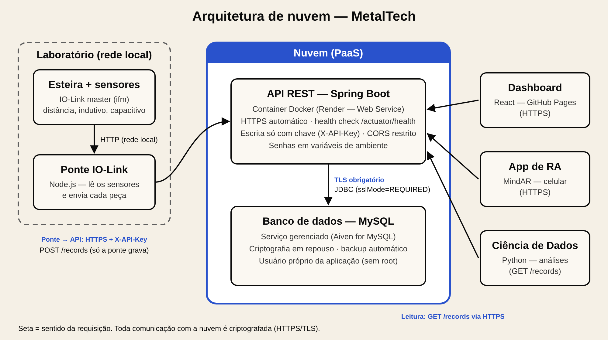

# Computação em Nuvem — Arquitetura da MetalTech

Documento de arquitetura de nuvem do Projeto Interdisciplinar II. Ele cobre o que a
situação-problema pede para a unidade de Computação em Nuvem (seção 5.3) e serve de base
para as seções **2.4** e **4.4** do relatório técnico.



> O diagrama também está em `arquitetura.svg` (vetorial, para editar) e `arquitetura.png`
> (para colar no relatório).

---

## 1. Visão geral

| Camada | Onde roda | Tecnologia |
|---|---|---|
| Sensores e ponte IO-Link | Laboratório (rede local) | IO-Link master ifm + Node.js |
| API REST | **Nuvem — PaaS** (Render, Web Service com Docker) | Java 25 / Spring Boot |
| Banco de dados | **Nuvem — DBaaS** (Aiven for MySQL) | MySQL 8 gerenciado |
| Dashboard | GitHub Pages (hospedagem estática) | React + Vite |
| App de RA | GitHub Pages, aberto no celular | A-Frame + MindAR |
| Ciência de Dados | Computador da equipe | Python |

Fluxo: a ponte lê os sensores no laboratório e envia cada peça por **HTTPS** para a API na
nuvem, que grava no MySQL. O dashboard, o app de RA e os scripts de Ciência de Dados leem os
mesmos dados pela API (`GET /records`).

---

## 2. Tabela de decisões (seção 4.4 do relatório)

| Aspecto | Decisão adotada | Justificativa |
|---|---|---|
| **Modelo de serviço do back-end** | **PaaS**: a API roda como container Docker num Web Service do Render. | O provedor cuida do sistema operacional, das atualizações de segurança, do HTTPS e do reinício automático. A equipe só entrega o código (Dockerfile). Com IaaS (uma VM), seria preciso administrar servidor, firewall e certificados, o que aumenta o trabalho e o risco de erro de segurança sem trazer vantagem para o tamanho do projeto. SaaS não se aplica, porque a API é um software próprio. |
| **Hospedagem do banco de dados** | **Banco gerenciado (DBaaS)**: Aiven for MySQL. | Mantém o MySQL que já é usado no projeto. O provedor faz backup, atualizações e criptografia. O banco não fica dentro do container da API, então os dados não se perdem quando a API é reiniciada ou atualizada. |
| **Controle de usuários e de acesso** | Leitura (`GET`) pública. Escrita (`POST`/`PUT`/`DELETE`) só com a chave de API (cabeçalho `X-API-Key`), que apenas a ponte IO-Link conhece. CORS restrito ao domínio do dashboard. A API acessa o banco com um usuário próprio, sem privilégios de administrador. O container roda com um usuário sem privilégios. | Aplica o **princípio do menor privilégio**: cada parte só tem o acesso de que precisa. Ninguém consegue inserir dados falsos sem a chave. O acesso ao painel do provedor fica restrito aos integrantes da equipe, com autenticação em dois fatores. |
| **Criptografia em trânsito** | **HTTPS (TLS)** entre ponte/dashboard/RA e a API. **TLS obrigatório** entre a API e o MySQL (`sslMode=REQUIRED`). | Impede que alguém na rede leia ou altere as leituras e a chave de API. O Render emite e renova o certificado HTTPS automaticamente. HTTPS também é exigido pelo navegador, porque o dashboard é publicado em HTTPS e não pode chamar uma API em HTTP. |
| **Criptografia em repouso** | Disco do banco e backups criptografados pelo provedor (Aiven). Senhas e chave de API guardadas como **variáveis de ambiente secretas** no provedor, nunca no código. | Se um disco ou backup vazar, os dados continuam ilegíveis. Tirar as senhas do repositório evita que qualquer pessoa com acesso ao GitHub tenha acesso ao banco. |
| **Disponibilidade do serviço** | Health check em `/actuator/health`: o provedor reinicia a API automaticamente se ela parar de responder. Deploy automático a cada push na `master`. Backup diário do banco feito pelo provedor. | Falhas da aplicação são corrigidas sem intervenção manual, e os dados podem ser restaurados. Se a API ficar fora do ar, a ponte guarda as leituras numa fila e reenvia depois, então nenhuma peça se perde. |
| **Escalabilidade** | A API não guarda estado (*stateless*): todo o estado fica no banco. Assim, é possível aumentar o plano (escala vertical) ou rodar várias instâncias atrás do balanceador do provedor (escala horizontal). O banco gerenciado também pode ter o plano aumentado sem migração. | Para o volume do projeto (uma esteira, poucas leituras por minuto), uma instância basta. A arquitetura já permite crescer para várias esteiras só mudando o plano, sem reescrever código. |
| **Aspectos econômicos (custos / contrato)** | Planos **gratuitos** durante o projeto acadêmico. Modelo **pay-as-you-go** (paga pelo que usa, sem contrato de longo prazo). | Custo zero para o protótipo. Em produção, a estimativa fica na faixa de dezenas de dólares por mês (plano pago de Web Service + MySQL gerenciado pequeno), muito abaixo de comprar e manter um servidor próprio. Não há fidelidade, então dá para trocar de provedor, porque a aplicação é um container Docker padrão. *Conferir os valores atuais na página de preços de cada provedor antes de colocar no relatório.* |

### Parâmetros do serviço hospedado

| Parâmetro | Valor |
|---|---|
| URL do serviço hospedado | `https://______.onrender.com` *(preencher depois do deploy)* |
| Região / provedor | API: Render (região mais próxima disponível). Banco: Aiven for MySQL (mesma região ou a mais próxima). |

### Limitações conhecidas

- No plano gratuito do Render, a API "dorme" depois de um tempo sem requisições, e a primeira
  requisição seguinte demora alguns segundos. Durante a operação da esteira isso não acontece,
  porque a ponte envia dados o tempo todo. Em produção, um plano pago elimina esse atraso.
- A leitura (`GET`) é pública. Para dados sensíveis, o próximo passo seria login de usuários
  (por exemplo, Spring Security com JWT).

---

## 3. Texto de apoio para a seção 2.4 (fundamentação)

**Modelos de serviço.** Na computação em nuvem, o provedor oferece recursos computacionais sob
demanda, pela internet. No **IaaS** (Infraestrutura como Serviço) o cliente recebe máquinas
virtuais, rede e armazenamento, e administra tudo do sistema operacional para cima (ex.: AWS EC2,
Azure Virtual Machines). No **PaaS** (Plataforma como Serviço) o provedor também gerencia o sistema
operacional e o ambiente de execução, e o cliente entrega apenas a aplicação (ex.: Render, Heroku,
Azure App Service). No **SaaS** (Software como Serviço) o cliente usa um software pronto pela
internet (ex.: Gmail, Google Classroom).

**Virtualização.** É a técnica que permite dividir um servidor físico em vários ambientes isolados.
As máquinas virtuais simulam um computador inteiro, com seu próprio sistema operacional. Os
**containers** (Docker) compartilham o núcleo do sistema operacional e isolam só a aplicação e suas
dependências, por isso são mais leves e sobem em segundos. Este projeto usa containers: a mesma
imagem roda no computador da equipe (`docker compose`) e no provedor de nuvem.

**Segurança.** Os principais cuidados são: **controle de acesso** (quem pode ler e escrever,
seguindo o princípio do menor privilégio), **criptografia em trânsito** (TLS/HTTPS, que protege os
dados enquanto trafegam pela rede), **criptografia em repouso** (dados armazenados em disco ficam
cifrados) e **gestão de segredos** (senhas e chaves fora do código-fonte). Na nuvem vale o **modelo
de responsabilidade compartilhada**: o provedor protege a infraestrutura física e a plataforma, e o
cliente é responsável pela aplicação, pelos dados e pelas credenciais.

**Disponibilidade e escalabilidade.** Disponibilidade é a porcentagem do tempo em que o serviço
está no ar, normalmente prometida em contrato (SLA). Ela é obtida com monitoramento (health checks),
reinício automático, redundância e backups. Escalabilidade é a capacidade de atender mais carga:
**vertical** (máquina mais potente) ou **horizontal** (mais instâncias em paralelo, com um balanceador
de carga distribuindo as requisições). A **elasticidade** permite aumentar ou reduzir recursos
conforme a demanda.

**Aspectos econômicos.** A nuvem troca o investimento inicial em servidores (CAPEX) por um custo
operacional mensal (OPEX). O modelo mais comum é o **pay-as-you-go**, em que se paga pelo uso, mas
também existem instâncias reservadas (desconto em troca de compromisso de 1 a 3 anos) e planos
gratuitos para testes. Ao contratar, é preciso avaliar o SLA, a região dos dados (LGPD), o custo de
transferência de dados e o risco de dependência de um único fornecedor (*lock-in*), que neste
projeto é reduzido pelo uso de containers padrão.

---

## 4. Como rodar com Docker (local)

Requisito: Docker Desktop.

1. Na raiz do repositório, copie `.env.example` para `.env` e troque as senhas e a chave.
2. Rode:

```bash
docker compose up -d --build
```

3. A API fica em `http://localhost:8080`. Para conferir:
   - `http://localhost:8080/actuator/health` deve mostrar `{"status":"UP"}`;
   - `http://localhost:8080/records` lista as leituras.
4. Para parar: `docker compose down`. Os dados ficam guardados no volume `mysql_data`.
   Para apagar tudo, inclusive os dados: `docker compose down -v`.

O `compose.yaml` sobe dois containers: o **MySQL**, que não fica exposto para fora (só a API
acessa, pela rede interna do Docker), e a **API**, que só inicia depois que o banco estiver
pronto (*healthcheck*).

---

## 5. Como publicar na nuvem (passo a passo)

> Os nomes dos menus podem mudar. Os planos gratuitos dos provedores também mudam com o tempo,
> então confiram as condições atuais antes de criar as contas.

### 5.1 Banco de dados — Aiven for MySQL

1. Crie uma conta em https://aiven.io e um serviço **MySQL** no plano gratuito.
2. Quando o serviço estiver rodando, anote em *Connection information*: **host**, **port**,
   **user**, **password** e o nome do banco (normalmente `defaultdb`).
3. Crie um usuário só para a aplicação (aba *Users*) em vez de usar o `avnadmin`.

### 5.2 API — Render

1. Crie uma conta em https://render.com e conecte o GitHub.
2. *New → Web Service* → escolha o repositório `monitoramento-industrial`.
3. Configure:
   - **Language/Runtime:** Docker
   - **Root Directory:** `backend`
   - **Branch:** `master`
   - **Health Check Path:** `/actuator/health`
4. Em **Environment**, cadastre as variáveis (elas ficam secretas no provedor):

| Variável | Valor |
|---|---|
| `DB_URL` | `jdbc:mysql://HOST:PORTA/defaultdb?sslMode=REQUIRED` |
| `DB_USER` | usuário criado no Aiven |
| `DB_PASSWORD` | senha desse usuário |
| `API_KEY` | uma chave longa e aleatória (ex.: gerada com `openssl rand -hex 32`) |
| `CORS_ALLOWED_ORIGINS` | `https://helloojohnzz.github.io` |

5. Crie o serviço. Ao final, o Render mostra a URL pública (`https://....onrender.com`).
   Teste `https://....onrender.com/actuator/health`.

### 5.3 Ligar as outras partes na API da nuvem

- **Ponte IO-Link:**

```bash
API_URL=https://ENDERECO-DA-API/records API_KEY=sua-chave npm start
```

- **Dashboard:** em `frontend/.env`, defina `VITE_API_URL=https://ENDERECO-DA-API`, rode
  `npm run build` e copie `dist/` para `docs/` (como explica o README do front-end).
- **App de RA:** abra `.../ra/?api=https://ENDERECO-DA-API`.
- **Ciência de Dados:** usar a URL da API (`GET /records`) ou os dados de conexão do Aiven.

### 5.4 Evidências para o relatório

Prints sugeridos para as seções 4.4 e 5.1:

- painel do Render com o serviço **Live** e o health check passando;
- painel do Aiven com o MySQL rodando e o SSL obrigatório;
- `GET /records` respondendo pela URL HTTPS;
- um `POST` sem chave recebendo **401** e com a chave recebendo **200**;
- o dashboard publicado mostrando os dados vindos da nuvem.
